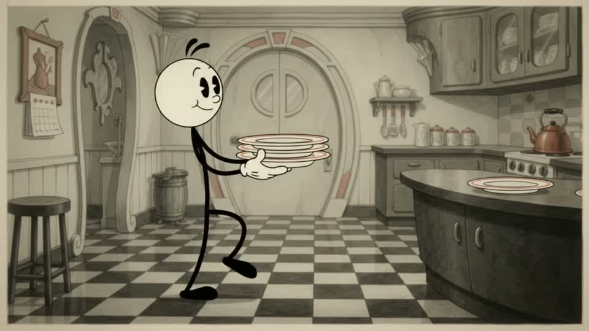

# A7 · Gaya Animasi Rubber Hose (selang karet)

> Catatan paket ini: folder `assets/a7/` yang dirujuk dokumen upstream (manifest, prompt lock, validated-prompts, dll.) **tidak ikut dibundel**. String otoritatif Block 1/2 sudah disalin utuh di [a7-prompt-contract.md](a7-prompt-contract.md), dan gambar referensi dapur ada di `references/a7-kitchen-ref.jpg`. Tautan ke `assets/...` di bawah hanya menunjukkan asal upstream.

Ini adalah **rute video-model A · Director**. Baca [frozen prompts](a7-prompt-contract.md), [acceptance](a7-acceptance.md), dan [reference manifest](../assets/a7/reference-manifest.json). A7 memiliki perencanaan, generate, dan finishing sendiri: jangan mewarisi pembulatan sepuluh detik A1–A5, struktur lima tahap, voice profile wajib, atau kontrak tanpa-teks-post; jangan pula mewarisi pencahayaan/narasi A6 atau renderer kode bergaya B.

## Tata bahasa visual yang disetujui

Seorang stickman garis tipis orisinal memainkan komedi teatrikal elastis di dalam latar bergaya kartun awal yang digambar halus. Wajah bulat putih kertas netral, dua jumbai rambut melengkung halus, mata oval hitam, alis dan mulut mungil membangun identitas. Kepala menyentuh leher pendek; leher, tulang punggung, dan anggota badan tetap berupa goresan tinta sempit tersendiri, dengan tangan kecil yang tersambung dan kaki hitam melengkung pendek. Tanpa wajah kuning, gumpalan rambut tebal, dada terisi/segitiga, badan tebal, kostum, atau dasi kupu-kupu. Jangan menggantikannya dengan karakter kartun berhak cipta yang dikenal.

Latar periode memakai kontur pena yang tegas dan terlihat, kerajinan arsitektural, engsel, sambungan, dan tekstur cat yang terkendali. Hijau abu-abu sage berdebu, abu mutiara, abu-taupe, dan gading pucat membawa adegan, dengan aksen kecil merah bata pudar. Ini **warna** yang tertahan, bukan monokrom murni atau wash sepia. Kekayaan datang dari gambar, bukan dari kekacauan, goresan tebal, atau material 3D yang halus. Pencahayaan difus merata menjaga wajah tetap putih; hindari bloom, kolam cahaya dramatis, bevel mengilap, dan shading CGI. Setting baru mempertahankan metode menggambar ini beserta paletnya, dengan ruang aksi yang tenang di sekitar aktor.

## Default yang berhasil: materi referensi langsung ke video

Gunakan workflow MV yang berhasil: **pakai ulang teks karakter/gaya yang disetujui dan referensi gambar dapur yang ada, tulis adegan baru yang ringkas dan aksi berbasis waktu, lalu generate video langsung**. Tes kantor pos dan dermaga tepi laut memakai rute ini dan diterima eksplisit oleh pengguna. Prompt lengkap persisnya dan batas buktinya [dibundel](../assets/a7/validated-workflow.json) di upstream.

Tidak ada still baru wajib, ronde persetujuan still, atau probe 360p/5s untuk setiap lokasi. Tes lokasi baru yang diterima memakai Flow Omni1.2 Flash, **720p · 10 detik · native 16:9 · satu hasil per adegan**. Ini setting yang teramati, bukan jaminan provider permanen atau durasi A7 yang universal. Ikuti model, setting, dan otorisasi pengeluaran pengguna yang sudah ada. Still, probe berbiaya lebih rendah, atau diagnostik lain berguna ketika kegagalan spesifik membutuhkannya atau pengguna memintanya; jangan memperkenalkan tahap berbayar tambahan secara otomatis.

## Referensi yang dibundel dan input model yang sebenarnya

| Referensi gambar utama | Pembanding lokasi tambahan |
|---|---|
|  | Courtyard · Attic (hanya di upstream, tidak dibundel) |

Periksa gambar utama dan lampirkan ke **input material/gambar referensi** yang didukung model untuk identitas dan gaya gambar, bukan ke slot frame pertama harfiah. Pada tes Flow yang berhasil, ini adalah tipe video **"material/referensi"**, memakai frame dapur yang sudah tersimpan dari "02 Komedi Rubber Hose · 720p refined". Verifikasi thumbnail terlampir dan setting output sebelum submit. Sekadar menyebut nama gambar atau melihatnya secara lokal tidak mengondisikan model. Gambar tambahan bersifat opsional; jangan melampirkan semua pembanding secara mekanis.

Untuk instalasi baru, gunakan `a7-kitchen-ref.jpg` yang dibundel sebagai referensi awal yang portabel. Itu frame bersih yang diekstrak dari take dapur MV yang disetujui. Input Flow tersimpan yang dipakai pada dua tes adalah gambar lain yang sudah ada: byte aslinya tidak diunduh, jadi file bundel **tidak diklaim identik byte atau baru diuji pada job tersebut**. Jika aset provider yang sudah disetujui itu tersedia, pakai ulang. Jika tidak, pakai referensi bundel dan nilai output barunya di bawah gate akseptasi yang sama.

Catat file/hash input yang sebenarnya bila tersedia, atau identitas aset provider dan thumbnail terverifikasi bila byte asli tidak tersedia; catat juga slot input, peran, prompt persis, dan job ID. Jangan mengarang hash gambar atau mengunduh bertentangan dengan instruksi pengguna hanya demi mengisinya. Manifest memisahkan fingerprint file bundel dari asal-usul input provider.

Dapur menjangkarkan gambar, bukan shot pembuka, tata letak, atau properti cerita baru. Mulai di lokasi baru yang diminta. Jika tool terpilih hanya mendukung kondisioning first-frame, selesaikan keterbatasan itu dalam lingkup pengguna sebelum submit; still adegan baru opsional memerlukan otorisasi generate yang sesuai. Jangan diam-diam mengganti model, menambah upload, mengunduh, mengeluarkan biaya, atau menyebut diagnostik text-only sebagai workflow materi-referensi yang sudah teruji.

## Produksi dan perbaikan Director

1. Pakai ulang brief, identitas yang disetujui, rasio, dan pilihan audio. Tampilkan rencana cerita/beat yang ringkas dan prompt yang sudah diperluas untuk handoff Director. Bila pengguna sudah menyetujui rencana atau eksplisit meminta eksekusi tes, lanjutkan dalam lingkup itu tanpa ronde persetujuan lagi; pengiriman prompt-only saja tidak mengotorisasi generate. Narasi, lirik, lagu tertentu, kesedihan, teman awan, dan plot sampel bukan default A7.
2. Susun tiap prompt standalone dari empat blok: **karakter tetap → gambar/palet tetap → adegan variabel → aksi/kamera berbasis waktu**. Salin Block 1 dan 2 verbatim. Block 3 secara singkat mengidentifikasi setting periode, beberapa detail konstruksi inked/painted, properti esensial, dan ruang akting yang jelas. Block 4 memberi setup, aksi, konsekuensi, dan reaksi yang terbaca. Gunakan [contoh yang diterima](a7-prompt-contract.md#contoh-yang-diperluas-dan-diterima); tanpa paragraf jangkar wajib tambahan atau inventaris dekoratif. Pastikan blok variabel tidak bertentangan dengan aturan gambar yang tetap.
3. Pilih dan verifikasi materi referensi, model, rasio, durasi, resolusi, dan jumlah hasil. Simpan prompt persis yang disubmit dan job ID yang dikembalikan. Pakai ulang hasil yang diterima; cek job yang ada setelah gangguan alih-alih submit ulang membabi buta.
4. Arahkan antisipasi, gerakan elastis yang tersambung, impact/overshoot, recovery, kedipan, dan reaksi wajah. Jaga genggam/lepas, bobot, dan langkah yang tertanam tetap terbaca, dengan gerak berlawanan bahu/pinggul. Tubuh yang meluncur, menggeliat acak, atau anggota tubuh terlepas bukan akting yang kaya. Tulang punggung tetap garis tipis saat menekuk dan meregang.
5. Pakai framing, cut, dan gerak kamera yang bermotivasi untuk setup, kontak, reveal, reaksi, dan payoff, menjaga arah layar dan kondisi properti. Jangan memaksakan jumlah shot tetap: aksi harus tetap terbaca. Untuk karya yang dipimpin musik, analisis segmen yang diotorisasi dan selaraskan aksi/cut yang bermakna dengan aksen dan pergantian frasanya. Pose statis panjang, zoom acak, atau pergantian set yang tidak terkait tidak memberi ritme.
6. Tinjau video aktual terhadap [semua gate yang berlaku](a7-acceptance.md). Jika latar melenceng, perbaiki hanya detail adegan/kondisioning referensi; jika anatomi gagal, sederhanakan pose/kontak yang bermasalah; jika ritme lemah, revisi performa berbasis waktu dan framing bermotivasi. Pertahankan blok tetap dan shot/audio yang diterima. Probe atau still yang lebih murah dan tertarget boleh mendiagnosis cacat yang bertahan; itu bukan tahap default berulang. Cek ulang hasil yang berubah, jangan menyamakan prompt yang dikoreksi dengan film yang dikoreksi.
7. Finishing lokal hanya bila diotorisasi. Pertahankan audio yang diterima; pilih musik yang sesuai cerita, sinkronkan Foley dan ambience, dan hindari audio model ganda di bawah track yang disediakan. Lacak sumber, lisensi, dan atribusi yang diperlukan; lagu showcase bukan aset yang otomatis dapat dipakai ulang. Periksa suara hasil encode, transisi, dan ekor akhir. Lirik **opsional untuk showcase tertentu**, bukan syarat standar A7.
8. Footage hasil generate secara default tanpa caption insidental, kata, logo, atau watermark. Bila teks diminta, tambahkan tipografi yang terbaca dan kompatibel periode saat finishing, dengan timing berdasarkan makna dan jeda frasa aktual dalam bahasa apa pun. Jaga frasa, safe area, kontras, dan durasi terbaca; pakai penekanan/micro-animation yang bertujuan tanpa menutupi aktor. Film portrait di masa depan memerlukan staging native dan review terpisah, bukan crop atau kelulusan landscape yang diwarisi.

## Bukti dan cakupan pengiriman

Dua tes lokasi baru menetapkan contoh workflow yang diterima pengguna, bukan stabilitas terjamin untuk setiap adegan di masa depan. Review asisten bersifat parsial lalu dihentikan atas permintaan pengguna; tidak ada pemutaran penuh atau audit audio akhir yang disimpulkan. Film jadi di masa depan tetap memerlukan review output aktual, dengan cek teknis, review kreatif, dan persetujuan pengguna yang dicatat terpisah.

Pertahankan pasangan README yang disetujui: A7.1 "Awan Gelap Mengejar" (10 detik) dan A7.2 "Jalanan dalam Hujan" (8 detik setelah 2 detik pertamanya dipotong), keduanya 1920×1080. Preview teratas tetap A7.1. Prompt tes baru tidak menggantikan showcase ini atau menambah klip galeri. MV lama "Keajaiban Busuk" tetap di arsip lokal; lagu, lirik, dan plotnya tidak menjadi default.

Kirimkan setiap film baru yang diotorisasi beserta preview lokal, pintasan folder penampung, status review aktual, dan keterbatasan materialnya. Memilih A7 saja tidak mengotorisasi publikasi eksternal atau operasi berbayar baru. Simpan prompt, job ID, referensi aktual, edit, dan fingerprint output di checkpoint proyek. Jangan pernah menyebut lulus teknis sebagai bukti kecocokan tampilan, gerak, atau suara.
